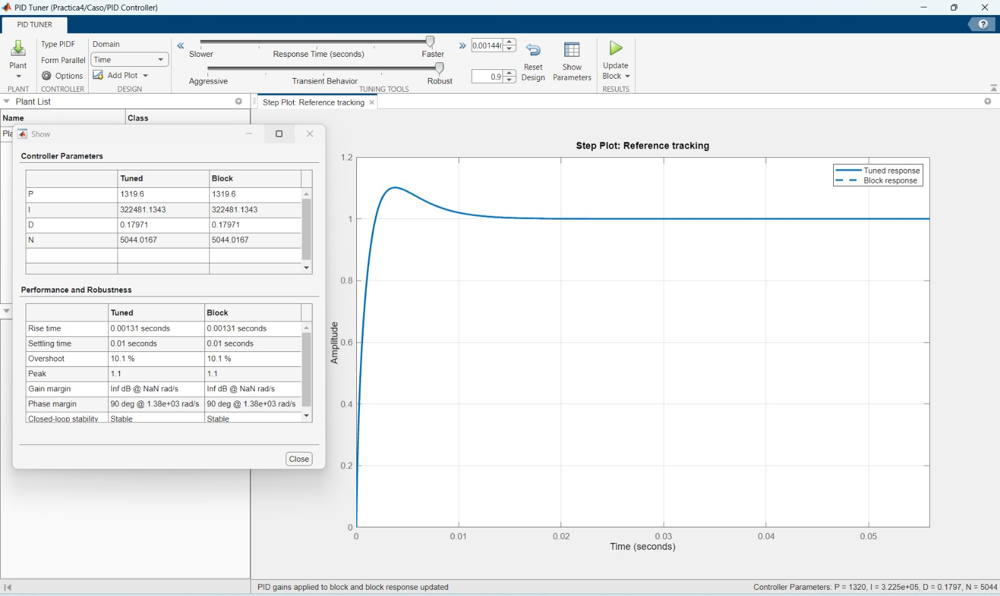
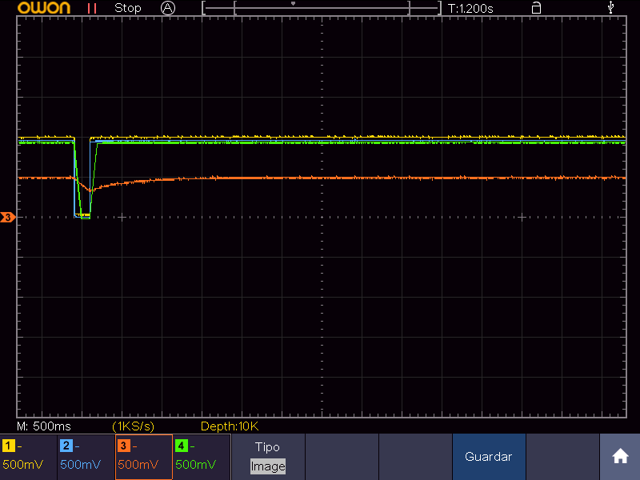
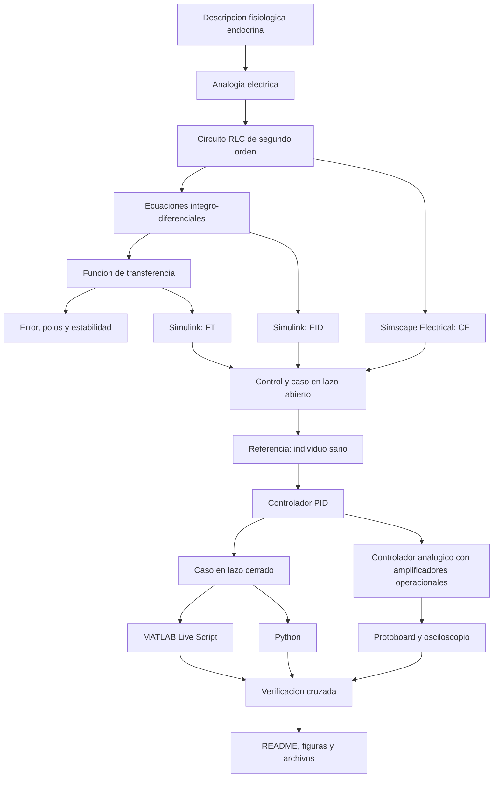

# Práctica 4 — Modelado y control del sistema endócrino

Repositorio académico de la asignatura **Modelado de Sistemas Fisiológicos**, correspondiente al programa de **Ingeniería Biomédica** del Tecnológico Nacional de México / Instituto Tecnológico de Tijuana. Esta práctica integra interpretación fisiológica, analogía eléctrica, formulación matemática, análisis temporal y de estabilidad, control clásico PID, simulación computacional (MATLAB, Simulink, Simscape Electrical y Python) y verificación experimental en el Laboratorio de Electrónica.

El caso de estudio representa de forma simplificada la dinámica de una señal hormonal mediante un circuito eléctrico de **segundo orden** formado por $R_1$, $C$, $L$ y $R_2$. Se compara una condición de referencia (**control**, individuo sano) con una condición alterada (**caso**, paciente), y se diseña un controlador **PID** que aproxima la respuesta del caso a la del control.

**Docente:** Dr. Paul Antonio Valle Trujillo  
**Correo:** paul.valle@tectijuana.edu.mx  
**Departamento:** Ingeniería Eléctrica y Electrónica  
**Institución:** Tecnológico Nacional de México / Instituto Tecnológico de Tijuana  
**Asignatura:** Modelado de Sistemas Fisiológicos  
**Programa:** Ingeniería Biomédica  
**Estudiante:** Gustavo Ortega Odabachea  
**Número de control:** 23212223  
**Correo institucional:** L23212223@tectijuana.edu.mx  
**Sede:** Blvd. Alberto Limón Padilla s/n, Tijuana, C. P. 22454, B. C., México.

---

<a id="contenido"></a>
## Contenido

1. [Resumen](#resumen)
2. [Competencia y objetivos](#objetivos)
3. [Relación con el temario](#temario)
4. [Interpretación fisiológica y analogía eléctrica](#analogia)
5. [Formulación matemática](#modelo)
6. [Análisis de error, estabilidad y bosquejo de la respuesta](#analisis)
7. [Entrada y condiciones de simulación](#senales)
8. [Implementación en MATLAB, Simulink y Simscape](#matlab)
9. [Control en lazo cerrado y sintonización PID](#pid)
10. [Diseño del controlador analógico](#analogico)
11. [Reproducción en Python](#python)
12. [Diagrama biológico](#biologico)
13. [Resultados computacionales y verificación cruzada](#resultados)
14. [Implementación experimental](#experimental)
15. [Discusión](#discusion)
16. [Conclusiones](#conclusiones)
17. [Flujo de trabajo y actividades](#flujo)
18. [Estructura del repositorio](#estructura)
19. [Requisitos y reproducibilidad](#requisitos)
20. [Referencias](#referencias)

---

<a id="resumen"></a>
## Resumen

La práctica desarrolla un procedimiento completo de **modelado, análisis, simulación, control y verificación experimental** de un compartimento endócrino simplificado. Un estímulo fisiológico $V_e(t)$ se transmite a través de una resistencia $R_1$ (pérdidas durante el transporte hormonal) hacia un capacitor $C$ (almacenamiento temporal) en paralelo con una rama $L$–$R_2$ (inercia y utilización del tejido diana). La salida $V_s(t)$ representa el nivel hormonal efectivo y normalizado disponible en el compartimento de interés.

Se estudian dos configuraciones: el **control** ($C=1\,\mu\mathrm{F}$, $R_2=100\,\mathrm{k}\Omega$) y el **caso** ($C=1000\,\mu\mathrm{F}$, $R_2=1\,\mathrm{k}\Omega$). A partir de las leyes de Kirchhoff y la transformada de Laplace se obtiene una función de transferencia de segundo orden para cada condición. Ambos sistemas resultan estables y sobreamortiguados, pero el caso responde mucho más lento y se estabiliza en $0.5\,\mathrm{V}$, frente a $0.99\,\mathrm{V}$ del control.

La respuesta del control se usa como referencia para el caso en un sistema de retroalimentación. La herramienta *PID Tuner* de Simulink entregó $k_P=1319.6$, $k_I=322481.1343$ y $k_D=0.17971$, que también se reproducen en Python mediante `python-control`. Con esas ganancias se calculan los componentes del controlador analógico con amplificadores operacionales y se contrastan los resultados con mediciones en protoboard.

**Palabras clave:** sistema endócrino; analogía eléctrica; circuito RLC de segundo orden; función de transferencia; controlador PID; MATLAB; Simulink; Simscape Electrical; Python; osciloscopio; simulación *in silico*.

[Volver al contenido](#contenido)

---

<a id="objetivos"></a>
## Competencia y objetivos

### Competencia a desarrollar

Modelizar sistemas fisiológicos mediante analogías eléctricas, ecuaciones diferenciales y funciones de transferencia para analizar su comportamiento dinámico, y diseñar estrategias de control mediante técnicas de control clásico, contrastando los resultados mediante modelado analítico, simulación computacional y experimentación.

### Objetivo general

Modelar un compartimento endócrino simplificado mediante un circuito eléctrico equivalente, comparar las respuestas de una condición de referencia y una condición alterada, y diseñar e implementar un controlador PID que reduzca la diferencia dinámica entre ambas.

### Objetivos específicos

- Interpretar los procesos de secreción, transporte, almacenamiento y respuesta hormonal y asociarlos con $V_e$, $F_e$, $R_1$, $C$, $L$, $R_2$, $F_s$ y $V_s$.
- Construir el circuito equivalente de control y caso.
- Obtener $G(s)=V_s(s)/V_e(s)$ y las funciones $G_{control}(s)$ y $G_{caso}(s)$.
- Calcular el error en estado estacionario y los polos, y determinar la estabilidad.
- Implementar ecuaciones integro-diferenciales, función de transferencia y circuito equivalente en Simulink/Simscape.
- Sintonizar un controlador PID y analizar su efecto en lazo cerrado.
- Reproducir el análisis en MATLAB (cuaderno) y Python.
- Calcular los componentes del controlador analógico con amplificadores operacionales.
- Construir los circuitos en protoboard y compararlos con la simulación.
- Documentar de forma reproducible archivos, resultados y limitaciones.

[Volver al contenido](#contenido)

---

<a id="temario"></a>
## Relación con el temario

| Unidad | Área | Contenidos aplicados |
|---|---|---|
| I | Sistemas de control retroalimentados | Diagrama de bloques, señal de error, respuesta temporal, estabilidad y retroalimentación negativa |
| II | Modelado matemático | Analogía eléctrica, ecuaciones integro-diferenciales, Laplace y función de transferencia |
| III | Controladores | Control PID, sintonización de ganancias y realización analógica con amplificadores operacionales |

El enfoque combina **Ingeniería de Control, Electrónica Analógica, Ciencias de la Computación y Fisiología**.

[Volver al contenido](#contenido)

---

<a id="analogia"></a>
## Interpretación fisiológica y analogía eléctrica

Las hormonas se liberan desde glándulas especializadas, se transportan por la circulación hasta los tejidos diana y producen respuestas cuya intensidad y duración dependen de procesos de producción, transporte, almacenamiento, utilización y eliminación. El modelo de la práctica es **fenomenológico y académico**: reproduce cualitativamente almacenamiento, disipación, retardo e inercia, pero no representa un eje hormonal específico ni equivale a magnitudes fisiológicas medidas.

| Variable o proceso fisiológico | Representación | Interpretación en el modelo |
|---|---|---|
| Estímulo para la secreción hormonal | $V_e(t)$ | Señal de entrada neural, metabólica u homeostática |
| Flujo de secreción y transporte | $F_e(t)$ | Corriente que sale de la fuente hacia el compartimento |
| Pérdidas y oposición durante el transporte | $R_1$ | Procesos que reducen o retardan la transmisión de la señal |
| Acumulación temporal de hormona | $C$ | Almacenamiento antes de su utilización o eliminación |
| Retardo o inercia de la respuesta del tejido | $L$ | Resistencia dinámica a cambios rápidos |
| Utilización, disipación o eliminación | $R_2$ | Oposición efectiva en el compartimento de respuesta |
| Flujo asociado con la respuesta del tejido diana | $F_s(t)$ | Corriente de la rama $L$–$R_2$ |
| Nivel hormonal efectivo | $V_s(t)$ | Salida normalizada en el nodo de unión de $R_1$, $C$ y $L$ |

### Topología del circuito

- Rama principal: fuente $V_e(t)$ en serie con $R_1$.
- Nodo posterior a $R_1$: capacitor $C$ a la referencia, en paralelo con la rama serie $L$–$R_2$.
- $V_s(t)$ se mide en el nodo de unión de $R_1$, $C$ y $L$; $F_e=F_c+F_s$, donde $F_c$ es la corriente del capacitor.
- Dos elementos independientes de almacenamiento de energía ($C$ y $L$) implican un sistema de **segundo orden**.

El esquema manuscrito del circuito, con $V_e$, $V_s$, $F_e$, $F_s$, $F_c$, nodos y referencia, se encuentra en la primera página de [`Analisis_matematico.pdf`](./Analisis_matematico.pdf).

### Parámetros del control y del caso

| Componente | Control | Caso |
|---|---:|---:|
| $R_1$ | $1\,\mathrm{k}\Omega$ | $1\,\mathrm{k}\Omega$ |
| $L$ | $100\,\mathrm{mH}$ | $100\,\mathrm{mH}$ |
| $C$ | $1\,\mu\mathrm{F}$ | $1000\,\mu\mathrm{F}$ |
| $R_2$ | $100\,\mathrm{k}\Omega$ | $1\,\mathrm{k}\Omega$ |

La modificación simultánea de $C$ y $R_2$ cambia las propiedades de almacenamiento y disipación del compartimento y, con ello, su dinámica.

[Volver al contenido](#contenido)

---

<a id="modelo"></a>
## Formulación matemática

### 1. Ecuaciones principales

Aplicando las leyes de Kirchhoff:

$$
V_e(t)-V_s(t)=R_1F_e(t),\qquad
F_c(t)=C\frac{dV_s(t)}{dt},\qquad
V_s(t)=L\frac{dF_s(t)}{dt}+R_2F_s(t),
$$

con $F_e(t)=F_c(t)+F_s(t)$. En forma integro-diferencial:

$$
V_e(t)=R_1F_e(t)+V_s(t),\qquad
V_s(t)=\frac{1}{C}\int\left[F_e(t)-F_s(t)\right]dt.
$$

### 2. Transformada de Laplace y procedimiento algebraico

Con condiciones iniciales nulas:

$$
V_e(s)=R_1F_e(s)+V_s(s),\qquad
V_s(s)=\frac{F_e(s)-F_s(s)}{Cs}=(Ls+R_2)F_s(s).
$$

De la segunda relación:

$$
F_e(s)=\left(CLs^2+CR_2s+1\right)F_s(s),
$$

y al sustituir en la primera:

$$
V_e(s)=\left[R_1CLs^2+(R_1R_2C+L)s+(R_1+R_2)\right]F_s(s).
$$

### 3. Función de transferencia

$$
\boxed{
G(s)=\frac{V_s(s)}{V_e(s)}
=\frac{Ls+R_2}{R_1CLs^2+(R_1R_2C+L)s+(R_1+R_2)}
}
$$

El orden dos de la función se relaciona directamente con los dos elementos de almacenamiento, $C$ y $L$.

### 4. Modelos numéricos

Para el **control**:

$$
\boxed{G_{control}(s)=\frac{0.1\,s+10^{5}}{10^{-4}s^{2}+100.1\,s+1.01\times10^{5}}}
$$

Para el **caso**:

$$
\boxed{G_{caso}(s)=\frac{0.1\,s+1000}{0.1\,s^{2}+1000.1\,s+2000}}
$$

Los desarrollos manuscritos se conservan en [`Analisis_matematico.pdf`](./Analisis_matematico.pdf). Los coeficientes coinciden con los bloques de función de transferencia de `sistema.slx` y con la función `sistema()` de `Ortega23212223.py`.

[Volver al contenido](#contenido)

---

<a id="analisis"></a>
## Análisis de error, estabilidad y bosquejo de la respuesta

### 1. Respuesta final y error en estado estacionario

Para $V_e(s)=1/s$, el valor final es $G(0)=R_2/(R_1+R_2)$ y el error es

$$
e_{ss}=\lim_{s\to0}s\cdot\frac1s\left[1-G(s)\right]=1-\frac{R_2}{R_1+R_2}.
$$

| Condición | $G(0)$ | Respuesta final | $e_{ss}$ |
|---|---:|---:|---:|
| Control | $0.9901$ | $0.9901\,\mathrm{V}$ | $9.9\times10^{-3}\,\mathrm{V}$ ($9.9\,\mathrm{mV}$) |
| Caso | $0.5$ | $0.5\,\mathrm{V}$ | $0.5\,\mathrm{V}$ |

La diferencia en estado estacionario entre ambas condiciones es de aproximadamente $0.49\,\mathrm{V}$, y se debe al divisor resistivo $R_2/(R_1+R_2)$ cuando $L$ se comporta como cortocircuito y $C$ como circuito abierto en régimen permanente.

### 2. Polos y estabilidad

Raíces del polinomio característico $R_1CLs^2+(R_1R_2C+L)s+(R_1+R_2)=0$:

| Condición | $p_1\ (\mathrm{s^{-1}})$ | $p_2\ (\mathrm{s^{-1}})$ | Tipo de respuesta |
|---|---:|---:|---|
| Control | $-1010.01$ | $-999\,989.99$ | Estable, sobreamortiguada |
| Caso | $-2.0002$ | $-9998.99$ | Estable, sobreamortiguada |

Todos los polos son reales y negativos (semiplano izquierdo). Sus constantes de tiempo dominantes son $\tau\approx1/1010\approx0.99\,\mathrm{ms}$ para el control y $\tau\approx1/2.0002\approx0.5\,\mathrm{s}$ para el caso. El aumento de $C$ y la disminución de $R_2$ desplazan el polo dominante hacia el origen, lo que vuelve el transitorio del caso aproximadamente 500 veces más lento.

### 3. Bosquejo cualitativo

- **Control:** respuesta casi instantánea (milisegundos), sin oscilaciones, con valor final cercano a $0.99$.
- **Caso:** crecimiento exponencial lento, sin oscilaciones, con constante de tiempo de $\approx0.5\,\mathrm{s}$ y valor final de $0.5$; se estabiliza en unos $2\,\mathrm{s}$ después del escalón.

Estas predicciones se confirman en las simulaciones de la sección [Resultados](#resultados).

[Volver al contenido](#contenido)

---

<a id="senales"></a>
## Entrada y condiciones de simulación

La práctica solicita un **escalón unitario** $V_e(t)=u(t)$ durante $t\in[0,10]\,\mathrm{s}$. En los archivos proporcionados el escalón se aplica en $t=1\,\mathrm{s}$ para observar el estado previo y el transitorio.

| Parámetro | Valor |
|---|---:|
| Tiempo inicial | $0\,\mathrm{s}$ |
| Tiempo final | $10\,\mathrm{s}$ |
| Paso máximo / de muestreo | $10^{-3}\,\mathrm{s}$ |
| Instante del escalón | $1\,\mathrm{s}$ |
| Solucionador de Simulink | `ode15s` |
| Condiciones iniciales | Nulas |

En Python la entrada se construye con

```python
t  = np.linspace(t0, tend, N)
Ve = (t >= 1.0).astype(float)
```

[Volver al contenido](#contenido)

---

<a id="matlab"></a>
## Implementación en MATLAB, Simulink y Simscape

El modelo [`sistema.slx`](./sistema.slx) contiene los subsistemas **Control** y **Caso**. En cada uno se construyen las tres representaciones solicitadas y se comparan entre sí:

| Representación | Bloques | Etiqueta de salida |
|---|---|---|
| Ecuaciones integro-diferenciales (EID) | Ganancias $1/R_1$, $1/R_2$, $1/C$, $L$, $R_2$, integrador, derivador y sumadores | `Vs(t): EID` |
| Función de transferencia (FT) | Bloque *Transfer Fcn* con los coeficientes de $G(s)$ | `Vs(t): FT` |
| Circuito equivalente (CE) | Simscape Electrical: fuente controlada, $R_1$, $C$, $L$, $R_2$, referencia eléctrica y sensor | `Vs(t): CE` |

El subsistema **Caso** incorpora además el bloque *PID Controller* en retroalimentación negativa (salida `PID: Tratamiento`). A nivel superior se encuentran el bloque *Step*, los *Scopes* y los bloques *To Workspace* para las señales de entrada, control, caso y tratamiento.

### Cuaderno de MATLAB

[`Ortega23212223.mlx`](./Ortega23212223.mlx) abre el modelo, configura la simulación, recupera las señales y las grafica con la función `plotsignals`, que exporta la figura en PDF vectorial. Su exportación está en [`Ortega23212223.pdf`](./Ortega23212223.pdf).

```matlab
open_system('sistema')
parameters.StopTime = '10';
parameters.Solver   = 'ode15s';
parameters.MaxStep  = '1e-3';
X = sim('sistema', parameters);
plotsignals(X.t, X.Ve, X.Vex, X.Vey, X.PID, 'Respuesta')
```

[Volver al contenido](#contenido)

---

<a id="pid"></a>
## Control en lazo cerrado y sintonización PID

### 1. Esquema de control

La respuesta del control se utiliza como referencia para el caso, y el controlador actúa sobre la señal de error:

$$
e(t)=V_{s,control}(t)-V_{s,caso}(t).
$$

La planta controlada es $G_{caso}(s)$, y el lazo cerrado es

$$
T(s)=\frac{C_{PID}(s)\,G_{caso}(s)}{1+C_{PID}(s)\,G_{caso}(s)}.
$$

### 2. Ganancias obtenidas con *PID Tuner*

Forma paralela, dominio del tiempo, con *Response Time* $=0.00144\,\mathrm{s}$ y *Transient Behavior* $=0.9$:

| Parámetro | Valor |
|---|---:|
| $k_P$ | $1319.6$ |
| $k_I$ | $322481.1343$ |
| $k_D$ | $0.17971$ |
| $N$ (coef. del filtro derivativo) | $5044.0167$ |

### 3. Indicadores reportados

| Indicador | Resultado |
|---|---:|
| Tiempo de subida | $0.00131\,\mathrm{s}$ |
| Tiempo de establecimiento | $0.01\,\mathrm{s}$ |
| Sobreimpulso | $10.1\,\%$ |
| Valor pico | $1.1$ |
| Margen de ganancia | Infinito |
| Margen de fase | $90^\circ$ a $1.38\times10^{3}\,\mathrm{rad/s}$ |
| Estabilidad en lazo cerrado | Estable |



El término integral (polo en el origen del controlador) lleva el error en estado estacionario a cero aun cuando la planta del caso tiene ganancia DC finita de $0.5$.

[Volver al contenido](#contenido)

---

<a id="analogico"></a>
## Diseño del controlador analógico

El controlador se realiza con un amplificador operacional con impedancia de entrada $Z_i=R_e\parallel C_e$ e impedancia de realimentación $Z_f=R_r+1/(C_rs)$. Su función de transferencia (magnitud, sin considerar la inversión de signo) es

$$
C_{PID}(s)=\frac{(R_eC_es+1)(R_rC_rs+1)}{R_eC_rs}
=\frac{R_eR_rC_eC_r\,s^2+(R_eC_e+R_rC_r)s+1}{R_eC_r\,s}.
$$

Fijando $C_r=0.1\,\mu\mathrm{F}$ y usando las relaciones de diseño del programa:

$$
R_e=\frac{1}{C_rk_I},\qquad R_r=k_PR_e,\qquad C_e=\frac{k_D}{R_r}.
$$

| Componente | Valor calculado |
|---|---:|
| $C_r$ (propuesto) | $0.1\,\mu\mathrm{F}$ |
| $R_e$ | $31.01\,\Omega$ |
| $R_r$ | $40.92\,\mathrm{k}\Omega$ |
| $C_e$ | $4.39\,\mu\mathrm{F}$ |


[Volver al contenido](#contenido)

---

<a id="python"></a>
## Reproducción en Python

[`Ortega23212223.py`](./Ortega23212223.py) utiliza `numpy`, `matplotlib` y `python-control`:

1. Define el vector temporal y el escalón en $t=1\,\mathrm{s}$.
2. Registra los parámetros $[R_1,L,C,R_2]$ del control y del caso.
3. Construye las funciones de transferencia con `ctrl.tf` y calcula los polos con `np.roots`.
4. Calcula $R_e$, $R_r$ y $C_e$ a partir de $k_P$, $k_I$, $k_D$ y $C_r$.
5. Construye el PID y el sistema del caso en retroalimentación negativa con `ctrl.feedback`.
6. Calcula las respuestas con `ctrl.forced_response`, usando la respuesta del control como referencia del lazo cerrado.
7. Grafica entrada, control, caso y tratamiento, y guarda [`Respuesta_python.pdf`](./Respuesta_python.pdf).

La función principal del modelo es:

```python
def sistema(R1, L, C, R2):
    num = [L, R2]
    den = [R1*L*C, R1*R2*C + L, R1 + R2]
    sys = ctrl.tf(num, den)
    P = np.roots(den)
    return sys, P
```

[Volver al contenido](#contenido)

---

<a id="biologico"></a>
## Diagrama biológico


El diagrama debe relacionar tres niveles de representación: (1) el **sistema biológico** (glándula, circulación, tejido diana), (2) el **modelo conceptual** (estímulo, transporte, almacenamiento, inercia y utilización) y (3) el **circuito equivalente** ($V_e$, $R_1$, $C$, $L$, $R_2$, $V_s$).

### Limitaciones fisiológicas

- El modelo es lineal, concentrado y con parámetros constantes.
- No representa un eje hormonal específico (insulina–glucosa, tiroideo, etc.) ni sus ciclos de retroalimentación biológica.
- Los valores de los componentes no equivalen a parámetros fisiológicos medidos.
- La diferencia entre control y caso se reduce a $C$ y $R_2$; no incluye la complejidad bioquímica, metabólica ni neural de una alteración endócrina real.

[Volver al contenido](#contenido)

---

<a id="resultados"></a>
## Resultados computacionales y verificación cruzada

### Respuestas en lazo abierto y cerrado

| Magnitud | Control | Caso | Caso con PID |
|---|---:|---:|---:|
| Valor final de $V_s$ | $0.9901\,\mathrm{V}$ | $0.5000\,\mathrm{V}$ | $0.9901\,\mathrm{V}$ |
| Error respecto del control | — | $0.49\,\mathrm{V}$ | $\approx0$ |
| Polos | $-1010.01;\ -999\,989.99$ | $-2.0002;\ -9998.99$ | $-9999.04;\ -827.07;\ -330.55$ |
| Estabilidad | Estable | Estable | Estable |

Los valores de lazo abierto coinciden con el análisis manuscrito. Los polos de lazo cerrado y el valor final del caso con PID provienen de la ejecución de `Ortega23212223.py`.

Con las ganancias de Python, el lazo cerrado es

$$
T(s)=\frac{5.573\times10^{-8}s^{3}+9.801\times10^{-4}s^{2}+4.328\,s+1000}{3.658\times10^{-7}s^{3}+4.081\times10^{-3}s^{2}+4.334\,s+1000}.
$$

El caso con PID sigue la referencia del control con un pico transitorio de aproximadamente $1.06\,\mathrm{V}$ y error final nulo, frente al valor sostenido de $0.5\,\mathrm{V}$ del caso sin tratamiento.

### Archivos de resultados

| Resultado | Archivo |
|---|---|
| Reporte del cuaderno MATLAB | [`Ortega23212223.pdf`](./Ortega23212223.pdf) |
| Figura exportada por MATLAB/Simulink | [`Respuesta_matlab.pdf`](./Respuesta_matlab.pdf) |
| Figura exportada por Python | [`Respuesta_python.pdf`](./Respuesta_python.pdf) |
| Evidencia de sintonización | [`Propiedades_PID.jpeg`](./Propiedades_PID.jpeg) |
| Análisis matemático manuscrito | [`Analisis_matematico.pdf`](./Analisis_matematico.pdf) |

### Verificación cruzada

Las cinco implementaciones solicitadas deben describir la misma dinámica:

| Implementación | Archivo / bloque | Estado |
|---|---|---|
| Ecuaciones integro-diferenciales | `sistema.slx` → `Vs(t): EID` | Incluida |
| Funciones de transferencia | `sistema.slx` → `Vs(t): FT` | Incluida |
| Circuito equivalente | `sistema.slx` → `Vs(t): CE` (Simscape Electrical) | Incluida |
| Cuaderno MATLAB | `Ortega23212223.mlx` | Incluida |
| Código Python | `Ortega23212223.py` | Incluida |

Las diferencias entre MATLAB/Simulink y Python pueden atribuirse a:

- El solucionador y el paso de integración (`ode15s` con paso máximo de $10^{-3}\,\mathrm{s}$ frente a `forced_response` con $\Delta t=10^{-3}\,\mathrm{s}$).
- El PID de Simulink emplea filtro derivativo ($N=5044.0167$), mientras que el controlador de Python es la realización analógica sin filtro y con $k_P$ efectiva ligeramente mayor.
- El redondeo de las ganancias.

[Volver al contenido](#contenido)

---

<a id="experimental"></a>
## Implementación experimental

### Montaje en protoboard

Los circuitos del control y del caso, junto con el controlador analógico basado en amplificadores operacionales, se construyeron en protoboard con los valores comerciales especificados. El instrumental empleado fue generador de funciones, fuente de alimentación simétrica para los amplificadores operacionales y osciloscopio OWON.


*(Pendiente: indicar qué sección del montaje corresponde al circuito RLC, al controlador y a los puntos de medición $V_a$ y $V_b$.)*

### Captura del osciloscopio



Parámetros de la captura: base de tiempo de $500\,\mathrm{ms/div}$, escala vertical de $500\,\mathrm{mV/div}$ en los cuatro canales, muestreo de $1\,\mathrm{kS/s}$ y profundidad de memoria de $10\mathrm{K}$. En la captura se observa una excitación en forma de pulso descendente en los canales de entrada, y una respuesta (canal 3, naranja) que cae y luego recupera su nivel de reposo con una evolución exponencial lenta, coherente con la dinámica de primer orden dominante del sistema.

| Canal | Color | Señal medida |
|---|---|---|
| 1 | Amarillo | Entrada |
| 2 | Azul | Control |
| 3 | Naranja | Caso |
| 4 | Verde | PID |


### Fuentes de diferencia entre simulación y experimento

- Tolerancias de resistores, capacitores e inductores.
- Resistencia interna y comportamiento no ideal del inductor de $100\,\mathrm{mH}$.
- Tolerancia y resistencia serie equivalente (ESR) de los capacitores electrolíticos.
- Valores comerciales empleados en el controlador, que difieren de los calculados.
- Ancho de banda finito, saturación y alimentación simétrica de los amplificadores operacionales.
- Resolución y limitaciones del osciloscopio y del generador de funciones.
- El generador produce una aproximación del escalón (pulso con tiempos de subida y bajada finitos), no un escalón ideal.

[Volver al contenido](#contenido)

---

<a id="discusion"></a>
## Discusión

- **Efecto de $C$ y $R_2$.** Aumentar $C$ de $1\,\mu\mathrm{F}$ a $1000\,\mu\mathrm{F}$ incrementa la capacidad de almacenamiento y desplaza el polo dominante de $-1010$ a $-2$ rad/s; reducir $R_2$ de $100\,\mathrm{k}\Omega$ a $1\,\mathrm{k}\Omega$ aumenta la disipación y reduce el valor final de $0.99$ a $0.5$. En conjunto, el caso es más lento y alcanza un nivel hormonal efectivo menor.
- **Sin oscilaciones.** Ambos sistemas son de segundo orden pero con polos reales y muy separados, por lo que su respuesta se comporta prácticamente como de primer orden.
- **Efecto del controlador.** El PID con acción integral elimina el error estacionario y acelera la respuesta del caso hasta igualarla con la referencia, a costa de un sobreimpulso transitorio. El tiempo de establecimiento pasa de ≈2 s (lazo abierto) a ≈10 ms (valor reportado por *PID Tuner*).
- **Control ideal frente a analógico.** La diferencia entre el PID ideal y la realización con amplificadores operacionales (efecto de $C_e/C_r$ sobre $k_P$, ausencia de filtro derivativo, valores comerciales) explica parte de las discrepancias entre resultados computacionales y experimentales.
- **Alcance del modelo.** Es una analogía cualitativa y académica; el controlador PID representa un protocolo de tratamiento *in silico*, no una terapia real.

[Volver al contenido](#contenido)

---

<a id="conclusiones"></a>
## Conclusiones

1. El circuito $R_1$–$C$–($L$+$R_2$) reproduce cualitativamente el almacenamiento, la disipación y la inercia asociados con la respuesta hormonal y resulta en un sistema dinámico de segundo orden.
2. El control y el caso son estables y sobreamortiguados, con valores finales de $0.99\,\mathrm{V}$ y $0.5\,\mathrm{V}$, respectivamente; la alteración de $C$ y $R_2$ vuelve al caso unas 500 veces más lento y reduce su respuesta final.
3. Las representaciones por ecuaciones, función de transferencia y circuito equivalente, junto con MATLAB y Python, permiten verificar de forma cruzada la dinámica del sistema.
4. Un controlador PID con $k_P=1319.6$, $k_I=322481.1343$ y $k_D=0.17971$ lleva la respuesta del caso hacia la referencia sana con error final nulo y respuesta rápida.
5. La implementación analógica introduce desviaciones respecto del diseño ideal que deben considerarse al comparar simulación y experimento.

[Volver al contenido](#contenido)

---

<a id="flujo"></a>
## Flujo de trabajo y actividades



### Actividades de la práctica

**Etapa 1. Modelado y análisis**
- [x] Interpretar la descripción fisiológica y construir el circuito equivalente.
- [x] Obtener $G_{control}(s)$ y $G_{caso}(s)$.
- [x] Calcular el error en estado estacionario y los polos.
- [x] Bosquejar cualitativamente la respuesta temporal.
- [x] Formular las ecuaciones integro-diferenciales.

**Etapa 2. Simulación y control**
- [x] Implementar EID, FT y CE en Simulink/Simscape.
- [x] Analizar la respuesta en lazo abierto.
- [x] Construir el sistema de retroalimentación y sintonizar el PID.
- [x] Analizar la respuesta en lazo cerrado.

**Etapa 3. Verificación computacional**
- [x] Desarrollar el cuaderno de MATLAB y la función de graficación.
- [x] Reproducir el análisis en Python.
- [x] Calcular los componentes del controlador analógico.

**Etapa 4. Experimentación y documentación**
- [x] Construir los circuitos en protoboard.
- [x] Capturar señales con el osciloscopio (captura incluida).
- [x] Incorporar capturas de lazo abierto (control y caso) y de lazo cerrado.
- [x] Completar la comparación simulación–experimento.
- [x] Incorporar el diagrama biológico (BioRender).
- [x] Incorporar `CITATION.cff` con los datos definitivos del repositorio.

[Volver al contenido](#contenido)

---

<a id="estructura"></a>
## Estructura del repositorio

```text
.
├── README.md                              # Reporte y guía de reproducción
├── CITATION.cff                           # Datos de citación (pendiente)
├── Ortega23212223.mlx                     # Cuaderno MATLAB
├── Ortega23212223.pdf                     # Exportación del cuaderno
├── Ortega23212223.py                      # Implementación Python
├── sistema.slx                            # Modelo Simulink/Simscape
├── Analisis_matematico.pdf                # Análisis matemático manuscrito
├── Diagrama_Biologico.png                 # Diagrama biológico (BioRender)
├── Propiedades_PID.jpeg                   # Evidencia de sintonización del PID
├── Respuesta_matlab.pdf                   # Figura MATLAB/Simulink
├── Respuesta_python.pdf                   # Figura Python
├── Circuito_lab.jpeg                      # Fotografía del montaje experimental
└── Respuesta_lab.jpg                      # Captura del osciloscopio
```

Si algún archivo se renombra o se mueve a una subcarpeta, deben actualizarse sus rutas relativas en este README.

[Volver al contenido](#contenido)

---

<a id="requisitos"></a>
## Requisitos y reproducibilidad

### MATLAB

- MATLAB con Simulink, Simscape y Simscape Electrical.
- Control System Toolbox y herramientas de sintonización del bloque `PID Controller`.

### Python

- Python 3 con `numpy`, `matplotlib` y `control` (`python-control`).

```bash
python -m pip install numpy matplotlib control
```

### Secuencia de reproducción en MATLAB/Simulink

1. Colocar `Ortega23212223.mlx` y `sistema.slx` en el mismo directorio.
2. Abrir el cuaderno y verificar `StopTime = 10`, `Solver = ode15s` y `MaxStep = 1e-3`.
3. Ejecutar todas las secciones.
4. Revisar las señales `Ve`, `Vex`, `Vey` y `PID` en el *Workspace*.
5. Confirmar la exportación de la figura en PDF.

### Secuencia de reproducción en Python

```bash
python Ortega23212223.py
```

Se imprimen los polos de control y caso, los valores de $R_e$, $R_r$ y $C_e$ y las funciones de transferencia del PID y del lazo cerrado, y se genera `Respuesta_python.pdf`.

### Criterios de presentación académica

- Distinguir las exigencias del instructivo de las decisiones de implementación.
- Mantener unidades y nombres de variables consistentes: la salida del sistema es $V_s(t)$, aunque las figuras actuales etiquetan el eje con $V_e(t)$ por ser la misma magnitud de voltaje normalizado.
- Identificar el redondeo de ganancias entre Simulink y Python.

[Volver al contenido](#contenido)

---

<a id="referencias"></a>
## Referencias

[1] M. C. Khoo, *Physiological Control Systems: Analysis, Simulation, and Estimation*, 2nd ed., IEEE Press, 2018.

[2] F. C. Hoppensteadt y C. S. Peskin, *Modeling and Simulation in Medicine and the Life Sciences*, Springer.

[3] J. E. Hall, *Guyton and Hall Textbook of Medical Physiology*, 14th ed., Elsevier, 2021.

[4] K. Ogata, *Ingeniería de Control Moderna*, 5a ed., Pearson Educación, 2010.

[5] N. S. Nise, *Control Systems Engineering*, 8th ed., John Wiley & Sons, 2020.

[6] P. A. Valle, *Syllabus para Modelado de Sistemas Fisiológicos*, Tecnológico Nacional de México / Instituto Tecnológico de Tijuana, Tijuana, B. C., México, 2026. Disponible en: <https://biomath.xyz/course/>.

[7] Tecnológico Nacional de México, *Programa de estudio de la asignatura Modelado de Sistemas Fisiológicos, IBF-1020*.

---

## Uso académico

Este repositorio documenta la práctica 4 de **Modelado de Sistemas Fisiológicos**. El modelo, las simulaciones, el controlador y los experimentos se emplean para desarrollar habilidades de interpretación, análisis matemático, programación, control, electrónica y documentación técnica. Cualquier cambio de parámetros, señal de entrada, estructura del controlador o procedimiento debe identificarse y justificarse.
